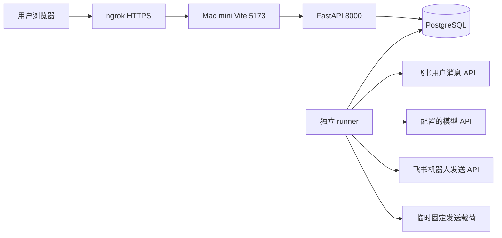

# 飞书个人会话总结助手技术设计

版本：v0.3｜更新：2026-10-10｜状态：当前实现基线，真实样本已跑通，完整验收待完成
对应需求：[需求文档 v0.1](./飞书个人会话总结助手-需求文档-v0.1.md)

本文依据后端 `4dfd22c`、前端 `c1e56ad` 的本地代码核对。文件名保留 v0.1 以兼容已有链接；旧设计可从 Git 历史查阅。本次只更新文档，不修改程序、配置或远程部署。用户提供的 Mac mini 成功任务截图属于样本证据，不代表远端已部署上述全部提交，尤其是最新 runner 日志功能。

## 1. 实现结论与差异总览

当前是两个仓库组成的模块化单体：React 网页、FastAPI API、独立 runner、PostgreSQL。runner 使用员工授权读取消息，调用配置的 Kimi/OpenAI-compatible 模型，再由飞书应用机器人私发总结。无需 Redis、独立消息队列或向量数据库。

当前使用路径是 Mac mini 原生服务加 ngrok；Linux Docker Compose 保留为另一套部署模板。真实消息采集、模型总结和机器人送达已有用户提供的成功样本；全量消息覆盖、1000 条性能目标、连续 7 天试点、生产恢复目标仍未验收。

按独立设计主题归并，本轮发现 **30 项需要修订的差异**。这是文档差异清单，不是 30 个程序缺陷，也不据此计算完成百分比。表中的“未实现”是旧设计承诺与代码间的缺口；正文以实际行为为准。

| # | 旧设计或旧状态 | 当前实现／处理 | 依据 |
|---|---|---|---|
| 01 | Linux 云主机、Compose 为首版主路径 | 补充当前 Mac mini 原生 + ngrok 路径；容器为可选模板 | 第 11 节 |
| 02 | 前端生产静态服务，不运行 Vite | 当前试点实际运行 Vite；不能等同生产 Nginx 安全配置 | 第 11 节 |
| 03 | 规划的多层模块目录 | 替换为真实的平铺模块和页面位置 | 第 2 节 |
| 04 | Node LTS、待锁定依赖 | Node 22，Python 3.12，npm/uv 锁文件已存在 | 第 2 节 |
| 05 | bootstrap 获取身份模式 | 未实现该模式／环境变量，仍需应用内正确 open_id 名单 | 第 4 节 |
| 06 | state/session 的消费、撤销字段 | 实际删除记录使其失效；字段并非原设计所列 | 第 4、8 节 |
| 07 | 分列令牌密文、key_id、密钥轮换 | 单一 AES-GCM JSON 密文、v1 格式；无多密钥轮换工具 | 第 4 节 |
| 08 | 刷新锁超时、精细保活调度 | 用户锁等待无独立超时；小时维护与使用前检查 | 第 4 节 |
| 09 | user_settings、run_steps 独立表 | 设置并入 users，步骤存 summary_runs JSON | 第 8 节 |
| 10 | 更丰富的管理员审计字段 | 实际仅操作者 ID、路由、结果、请求 ID 和时间 | 第 5、8 节 |
| 11 | 手动创建返回 202、429 带 retry_after | 当前返回 200；429 无专用 retry_after 字段 | 第 5 节 |
| 12 | 管理列表默认仅有效用户等状态口径 | 默认列出已授权业务用户；状态并非每次实时向飞书核验 | 第 5 节 |
| 13 | 全套覆盖计数设计 | 改为实际采集字段，区分发现、读取、可总结、上下文 | 第 6 节 |
| 14 | 按 token／语义组织模型输入 | 实际按字符分块，一层分批合并；无完整语义分组 | 第 7 节 |
| 15 | 旧总结 schema | 改为 topics/decisions/actions 与五种 category | 第 7 节 |
| 16 | 报告包含来源定位附录 | 按用户要求取消；来源仅用于模型内部校验 | 第 7 节 |
| 17 | 通用模型处理与笼统格式失败 | 增加 K3 JSON Mode、截断修复和细分错误码 | 第 7、10 节 |
| 18 | 按主题分卡、超限降级文本 | 实际按 5000 字符切分及字节校验，无文本降级 | 第 7 节 |
| 19 | 应用 token 缓存 | 当前发送路径获取 bot token，无跨任务缓存 | 第 10 节 |
| 20 | 统一指数退避等重试策略 | 各类调用策略不同；模型暂只重试一次 | 第 10 节 |
| 21 | 可配置并发与每用户限额 | 总执行槽位固定为 2；请求 gate 在单进程内 | 第 9、10 节 |
| 22 | 实测模型 token／费用指标 | 仅字节与输出上限预留预算，无实际账单统计 | 第 10 节 |
| 23 | 所有正文仅内存／tmpfs | Mac 本地发送载荷可落磁盘；production 才强制 Linux tmpfs | 第 8、11 节 |
| 24 | 每日自动备份、异地保存 | 已有配置备份工具和执行时 7 天清理；调度和异地复制未实现 | 第 12 节 |
| 25 | 联合发布及生产部署流水线 | CI 检查、镜像构建、清单校验已实现；无自动发布部署 | 第 12 节 |
| 26 | 心跳两分钟告警及外部告警 | 实际健康阈值 90 秒，提供快照，无外部告警投递 | 第 12 节 |
| 27 | 缺少当前后台服务管理方式 | 补充 services.sh、PID 身份检查及优雅停止边界 | 第 11 节 |
| 28 | 仅设计运行指标，正常日志说明缺失 | 补充已实现的 runner JSON 元数据日志与路径 | 第 12 节 |
| 29 | 仍处于待创建项目／等待真实配置 | 已开发并有真实双用户成功样本；保留未验收项目 | 第 13 节 |
| 30 | 配置版本是统一执行失效条件 | 已记录版本、设置变更取消排队任务；执行许可核心检查为授权代次和用户状态，不逐次比较 config_version | 第 9 节 |

## 2. 仓库、技术栈与代码边界

| 层 | 当前实现 | 代码入口 |
|---|---|---|
| Web | React 19、TypeScript、Vite 6、Ant Design 5、React Router；Node >=22 <23 | 前端 src/main.tsx、src/pages/、src/api/ |
| API | Python 3.12、FastAPI、Uvicorn、SQLAlchemy、Pydantic、HTTPX | app/main.py、app/oauth.py、app/security.py、app/schemas.py |
| 业务与存储 | PostgreSQL，Alembic 迁移；生产模板及 Mac 安装基线为 PostgreSQL 16 | app/db.py、app/services.py、alembic/ |
| 后台执行 | 同一后端代码，独立 Python 进程 | app/runner.py、app/leases.py、app/maintenance.py |
| 消息与模型 | 采集、飞书客户端、总结、卡片和发送分离 | app/collector.py、app/pipeline.py、app/summarizer.py、app/cards.py、app/delivery.py |
| 临时数据与运维 | 固定发送载荷、日志、健康、配置备份、发布验证 | app/payloads.py、app/runlog.py、app/health.py、app/backup.py、app/release.py |
| 本地进程管理 | Bash 入口，Python 管理器 | scripts/services.sh、scripts/local_services.py |

依赖由后端 uv.lock、前端 package-lock.json 锁定。前端契约副本为 contracts/openapi.json，生成 src/api/generated.ts；后端导出契约。CI 各自验证本仓库生成结果，跨仓库同步仍需操作，不能只改一边。

## 3. 当前架构与执行链路



API 负责登录、授权、设置、创建任务和查询元数据；不会在一次网页请求中完成整份总结。runner 从数据库领取任务，执行采集 → 总结 → 固定载荷 → 分段发送，并持久化阶段和结果。只启动 API 时网页可以访问，但任务不会被后台处理。

每日定时和手动执行均主动拉取消息，当前不依赖机器人消息事件订阅或 WebSocket 长连接。飞书控制台“事件与回调”不是网页登录 OAuth 重定向地址的配置入口。

## 4. 身份、权限与 OAuth

### 4.1 应用配置与路由

使用同一个企业自建应用提供网页和机器人。ALLOWED_TENANT_KEY 限定企业；PILOT_OPEN_IDS 授予个人助理权限；ADMIN_OPEN_IDS 授予后台查询权限。管理员若也要个人总结，必须同时在试点名单。open_id 必须从当前应用取得，其他应用的 ID 不能直接复用；应用可用范围、通讯录权限和本地名单是不同约束。

| 用途 | 发起入口 | 正确回调 |
|---|---|---|
| 网页身份登录 | GET /auth/login/start | https://<服务域名>/auth/login/callback |
| 授权消息访问 | POST /auth/feishu/start | https://<服务域名>/auth/feishu/callback |

上述地址以 app/oauth.py 为准。消息授权回调不是 `/auth/authorize/callback`；此前部署交流中的该写法应更正。PUBLIC_BASE_URL 必须与浏览器使用的公网 origin 一致，不附路径。先通过 ngrok 提示页，再从首页重新发起登录；不要重复使用旧授权回调 URL。

登录请求与消息授权分开。登录获得身份后不保存其飞书 token；个人授权才保存业务凭证。消息授权请求的 scope 当前为 offline_access、search:message、im:message:readonly、im:message.p2p_msg:get_as_user、im:message.group_msg:get_as_user（精确字符串以 app/oauth.py 为准）。权限能否批准及实际覆盖仍由租户验证。

### 4.2 会话与安全边界

- OAuth state 有效期 5 分钟，数据库保存哈希，绑定浏览器 Cookie、用途；消息授权还绑定发起会话。回调行锁验证后删除 state，再请求飞书。
- 本地 Session 存随机值哈希，绝对有效期 8 小时、空闲 30 分钟；用户活动接口更新活动时间。退出删除 Session，不停止每日任务。
- HTTPS 使用 __Host-session，HttpOnly、Secure、SameSite=Lax、Path=/。修改接口校验同源 Origin（缺失时用 Referer）及 CSRF token。
- API 按当前企业、名单、角色和数据归属检查；管理员只能看运行元数据，不能查询他人聊天或报告正文。
- 当前无 bootstrap 身份收集模式。development 下拒绝登录可能向当前调用者返回其身份排障信息；这不等于不受限的注册流程。

### 4.3 凭证保存与刷新

user_tokens 保存一份 AES-GCM 加密 JSON，包含 token/scope 等返回字段；使用 32 字节密钥、随机 nonce 和用户绑定 AAD。v1 是密文格式标记，当前只有一个密钥文件，不具备 key_id 多密钥迁移或自动轮换工具。

使用前检查有效期和固定 refresh_after；小时维护处理启用用户的到期刷新。刷新由用户级数据库 advisory lock 串行化，当前锁等待没有独立超时。刷新失败或不确定结果进入重新授权流程，不靠无限重放刷新请求恢复。授权代次 auth_epoch 和 token 版本防止旧结果覆盖新凭证；授权失效提醒按代次去重。

## 5. Web 页面与 API 契约

前端有个人设置、我的任务、任务详情、授权用户、管理员任务列表和详情。页面及数据库运行记录不提供聊天正文或总结正文查看功能。

| API | 实际用途 |
|---|---|
| GET /api/public/login-options | 登录入口和演示配置 |
| GET /api/session；POST /api/session/activity；POST /api/logout | 当前身份、活动续期、退出 |
| GET/PATCH /api/me/settings | 设置及每日时间 |
| POST /api/me/enable、pause、resume、disable | 启用、暂停、恢复、停用；实现为 action 路由 |
| POST /api/me/runs | 创建手动任务，成功 HTTP 200 |
| GET /api/me/runs；GET /api/me/runs/{run_id} | 个人任务列表及详情，参数名以契约为准 |
| GET /api/admin/users | 当前企业已建立业务用户的列表及筛选 |
| GET /api/admin/runs；GET /api/admin/runs/{run_id} | 管理员任务查询 |
| GET /api/admin/health | 后台健康快照 |

成功响应包含 data/request_id，业务错误包含 error/request_id；字段与准确路径变量以 contracts/openapi.json 为准。手动任务使用 Idempotency-Key，24 小时内重复键返回原任务；存在活动任务返回 409；新手动请求间隔不足 5 分钟返回 429，当前没有专用 retry_after 字段。

任务列表默认近 7 天，可查询最长 30 天，按计划时间和 ID 排序。管理员用户列表默认不限定授权状态；只有身份登录、未建立助理用户的纯管理员不在该业务用户列表。授权状态反映最近授权／刷新等记录，不是列表查询时重新向飞书逐人核验。

管理员审计记录 actor_id、路由模板、allowed、request_id、created_at；无原始查询词、聊天、目标用户详情。停用删除业务凭证并取消任务；暂停停止自动计划但仍允许已授权用户手动总结。

## 6. 消息采集与覆盖口径

任务创建即冻结 [window_start, window_end)，默认过去 24 小时；UI 用北京时间显示，数据库时间带时区。三路搜索为私聊、群内直接 @本人、本人发送，按消息 ID 去重。直接 @过滤仅用于相应命中路径，不能把本人发送的普通消息一并过滤掉。

搜索逐页读取；收到结果不全 notice 时细分时间窗，最小到 5 分钟。等待至截止后 60 秒，再复查末尾 10 分钟以缓解索引延迟。读取消息正文后做本地时间／身份过滤，并补充会话附近或话题上下文。话题分页也做本地截止过滤；无法证明搜索索引绝无遗漏。

当前主要解析 text/post；其他类型可被读取但未转换为可总结文本。补充上下文不是额外的目标消息，不能混入“本次总结条数”。采集顺序不等于完善的按主题／时间排序算法。

| counts 字段 | 口径 |
|---|---|
| p2p、at_me、own | 初始各路采集计数，可能有交集，不可直接求和当总数 |
| tail_new、unique | 尾部新增、去重后发现消息数 |
| body_read、body_attempted、body_total | 正文读取成功、处理尝试和目标总数；读取成功不等于能解析成文本 |
| parsed | 可总结的目标文本数量 |
| context、unsupported | 补充上下文数量、遇到的未支持类型数量 |
| search_pages、history_pages、phase | 搜索分页、上下文分页、采集阶段 |

coverage_status 独立于 execution_status 和 delivery_status。complete 表示当前采集未发现已知缺口，不保证飞书所有消息均已覆盖；partial 表示部分读取、上下文或类型等存在缺口；no_data 表示无可用消息。没有历史计数字段时显示“未记录”，不能显示为 0。模型失败也可能保留已完成的采集计数。

前端已将覆盖原因映射为中文，例如“不支持的消息类型，未纳入总结”。正文处理成功 52/52 与 partial 可同时成立：类型解析、上下文读取仍可能不完整。

## 7. 模型总结与报告输出

输入仅包含采集到的可读文本及上下文，来源分配内部 S1 等编号。单条文本超过 12000 字符时切块；序列化输入按约 20000 字符分批抽取，多批结果再分批合并。这不是 tokenizer 分块，也没有任意层级递归归并。

输出 schema 为 topics、decisions、actions；条目含 summary、sources、category，以及可空 owner/deadline。category 是组织类、项目类、技术类、日常协作类、其他，未提供时默认其他。来源必须合法且包含目标消息，不能只依赖背景上下文；负责人和期限没有原文依据时清空；合并阶段检查来源集合完整性，再做精确规范化去重。

模型通过 MODEL_BASE_URL 下的 /chat/completions 调用。Kimi K3 分支使用 JSON Mode、reasoning_effort=low、max_completion_tokens，去掉通用 temperature。单次 HTTP 超时 120 秒；默认输出上限 6000，截断时在总预算内可提高到 12000 重试。一次任务的调用次数取决于抽取批数、合并批数和重试，不固定为一次。

报告按类别展示要点、决定和待办，仅显示非空类别。首部的北京时间窗口、窗口时长、目标文本数、额外上下文和未解析数来自程序计数，不由模型编造。按用户决定，不显示来源编号、消息 ID 或定位附录，但保留内部校验。

app/cards.py 将内容按 5000 字符切段，加段号，校验序列化发送内容不超过 24000 字节。使用静态 plain_text 卡片和设置入口，当前没有按完整段落优先切分或超限转纯文本降级。

## 8. 数据存储与隐私边界

| 实际表 | 保存内容 |
|---|---|
| identities | 企业内应用身份、姓名、访问状态 |
| users | 个人设置、授权／启用状态、下次计划、授权代次、配置版本 |
| user_tokens | 用户绑定的加密凭证、版本和有效期／刷新时间 |
| sessions | Session 哈希、身份、CSRF、有效期和活动时间 |
| oauth_states | 一次性 state 与浏览器／会话绑定及期限 |
| summary_runs | 任务窗口、各状态、租约／fencing／期限、步骤和计数 JSON、错误与重试元数据 |
| manual_requests | 手动请求幂等映射 |
| delivery_parts | 分段序号、固定 UUID、载荷哈希、发送状态和消息 ID |
| auth_notices | 授权失效通知去重记录 |
| user_execution_locks | 同用户执行租约 |
| worker_health | runner 心跳 |
| admin_access_audit | 管理员访问审计 |

数据库不保存聊天正文、模型输入输出或报告正文。没有 user_settings/run_steps 独立表；准确列、索引、约束以 app/db.py 和 Alembic 为准。业务数据库连接来自 DATABASE_URL，测试专用 summary_test，禁止用真实库跑会清表的测试。

原始消息与模型中间结果在进程内存处理；为发送恢复而冻结的最终载荷保存在 PAYLOAD_DIR，目录 0700、文件 0600，绑定任务／用户／授权代次，期限 24 小时，终态删除、runner 定期清理。Mac 的普通目录是磁盘文件，不能声称“全部只在内存”。production 模式强制检查 Linux tmpfs。

过期会话、state、手动幂等及超过 30 天的非活动任务、相关记录和审计由 runner 清理；清理依赖进程运行。用户配置不按运行历史期限自动删除。

## 9. 调度、执行权限与恢复

runner 每约 15 秒调度、恢复、清理并更新心跳。PostgreSQL advisory lock 保证单 runner 选主；最多两个任务槽位，用户执行锁防止同用户并发。没有 WORKER_CONCURRENCY 配置项，也不支持直接扩 runner 副本。

每日计划按 Asia/Shanghai 计算；枚举最多 30 天内错过的计划，超过 2 小时补偿范围标为 missed。任务租约 120 秒、每 20 秒续约，以 owner 和递增 fence 防止过期执行者写回。任务原始开始后 30 分钟为总期限，恢复不重置期限。

任务保存 config_version，但运行许可实际检查身份／名单、授权代次、授权和启用状态，未把每次 config_version 变化都作为中止条件。设置修改取消排队任务；暂停、停用、重新授权有各自取消逻辑。正在发送的外部 HTTP 操作无法撤回，取消后可能标为不确定。

主阶段是 queued → collecting → summarizing → ready_to_send → sending → succeeded，另有失败、取消、错过和发送不确定等终态。重试计数独立记录，并非所有重试都会进入 retry_wait。

发送前冻结载荷并持久化发送意图，UUID 根据任务／用途／分段确定。已确认成功的分段不重发；HTTP 结果未知时受控重试相同载荷。全部分段已确认时可恢复为成功；载荷丢失且曾尝试发送时保留失败／不确定，不能重新总结后盲发。系统不承诺 exactly-once。

## 10. 限流、重试和预算的实际边界

| 操作 | 当前策略 |
|---|---|
| 飞书通用读取请求 | 最多 4 次，5/20/60 秒等待；特定业务错误不重试，不解析 Retry-After |
| 搜索／正文请求 gate | 单进程分别约 1 秒／0.2 秒间隔；重试循环不重新进入 gate |
| 模型调用 | 最多 2 次；可重试网络等错误等待 1 秒，格式错误进入修复；鉴权／非限流请求错误不盲重试 |
| 分段发送 | 不确定结果最多 4 次，5/20/60 秒加抖动，受发送时间边界及任务总期限约束 |
| 用户 token 刷新 | 用户级锁；单次请求，不对不确定刷新结果无限重放 |
| 应用 bot token | 发送路径获取，目前无跨任务缓存 |

模型错误已区分超时、鉴权、限流、服务错误、请求错误、网络、截断、空输出、JSON/schema、来源、合并不完整和内容过滤。HTTP 200 不代表模型输出校验通过。

MODEL_TOKEN_BUDGET 默认 200000，按输入 JSON UTF-8 字节、预留输出及固定开销保守扣减，覆盖各批和重试。它不是供应商实际 token 统计，不保存实际 usage、账单费用或成功调用成本。更长限流退避、真实 token 计量、跨进程限流和 bot token 缓存均未实现。

## 11. Mac mini 部署与本地服务管理

当前试点链路：公网 HTTPS ngrok → 127.0.0.1:5173 Vite → /api、/auth 代理至 127.0.0.1:8000。数据库本机运行，runner 独立运行；/health 不经当前 Vite 代理。Vite allowedHosts 和 API 的 PUBLIC_BASE_URL 主机校验都需匹配入口域名。

部署顺序：克隆两个同级仓库 → 安装 Python 3.12/uv、Node 22、PostgreSQL、ngrok → 配置数据库、.env 和本机密钥文件 → 后端 uv sync --locked → 前端 npm ci → 后端 uv run alembic upgrade head → ngrok 认证及飞书 OAuth 地址配置 → 启动四个进程。原生部署不依赖 Docker。

| 配置 | 当前作用 |
|---|---|
| APP_ENV、MOCK_AUTH_ENABLED、LIVE_PIPELINE_ENABLED | Mac 原生试点使用 development、false、true；development 不等于 demo |
| PUBLIC_BASE_URL | 统一公网 HTTPS origin，决定回调和 Secure Cookie |
| DATABASE_URL | PostgreSQL 连接，凭证只存本机配置 |
| ALLOWED_TENANT_KEY、PILOT_OPEN_IDS、ADMIN_OPEN_IDS | 企业、个人试点、管理员名单 |
| FEISHU_APP_ID、FEISHU_APP_SECRET_FILE | 应用身份与密钥文件 |
| TOKEN_ENCRYPTION_KEY_FILE | Base64 编码 32 字节加密密钥文件 |
| MODEL_BASE_URL、MODEL_ID、MODEL_API_KEY_FILE | HTTPS 模型地址（含所需版本前缀）、模型 ID、密钥文件 |
| MODEL_TOKEN_BUDGET | 当前近似预算，不是实际账单限额 |
| PAYLOAD_DIR | 可写临时发送载荷目录；Mac 不使用 Linux 默认 /run 路径 |
| MAINTENANCE_MODE | 拒绝已认证的非只读请求；维护还需停止／排空执行进程 |

配置在进程内缓存，修改 .env 后需重启有关进程；复制仓库不会自动带上被忽略的配置与密钥。不要把密钥放进前端变量、Git、日志或文档。

在后端目录使用：

```bash
bash scripts/services.sh start
bash scripts/services.sh status
bash scripts/services.sh logs runner
bash scripts/services.sh stop
bash scripts/services.sh restart
```

脚本检查依赖、数据库表和端口，后台启动 API、Web、ngrok、runner，使用 .local-services/ 保存日志和进程记录。通过 PID、启动时间及命令核对身份，避免 PID 重用误杀；不接管已有手动进程。停止时先让 runner 排空，最多等待 30 秒，仍未退出则不强杀、不继续重启，应稍后再次检查。

脚本不安装依赖、不迁移数据库、不启动 PostgreSQL、不配置开机自启、不提供崩溃自动拉起或日志轮转。启动进程存活也不证明 ngrok 已上线。Mac 需要保持运行与联网；迁移后应停止旧机器的同类服务，避免域名隧道或后台任务竞争。

另一条部署路径是 deploy/compose.yaml：前端静态 Nginx、API、runner、PostgreSQL 和一次性迁移。该路径才包含容器 tmpfs、Nginx TLS／请求限制等配置；不能将这些保护写成 Mac Vite 路径已经生效。production 的 Linux tmpfs 检查不能原样用于原生 macOS。

## 12. 日志、健康、备份与发布

runner 已有 INFO JSON 日志：启动、5 分钟周期状态、任务领取／阶段／结束、采集进度、逐次模型调用及校验／重试、分段发送、退出。StreamHandler 逐条刷新 stderr，服务脚本重定向到后端 .local-services/runner.log；旧的 ~/Library/Logs 路径不会自动同步。run_id 关联任务，call_id 区分模型请求。

日志采用字段白名单，不包含聊天、总结、模型正文、凭证、收件人和任意异常文本。不能通过日志恢复历史正文；新增日志不补写旧任务。当前没有自动轮转；远程机器须拉取相关提交并重启才有新日志。

/health/live 检查 API 存活，/health/ready 检查数据库。管理员健康接口和 `uv run python -m app.health` 检查 runner 心跳、积压和未知发送：心跳超过 90 秒、计划时间超过 10 分钟仍活动或近 24 小时有未知送达则 degraded。它们不是外部告警投递服务，也不能把 API ready 当成 runner 正常。

app.backup 提供加密配置备份，字段白名单只导出 identities/users，不含业务凭证、Session、聊天和运行历史。每次执行备份清理所选目录内超过 7 天的对应归档；不自动每天执行或异地复制。恢复要求维护状态、停止服务、空应用库和一致迁移版本，恢复后 needs_reauth，非停用用户变为 paused，需重新授权与启用。

CI 已包含后端 Ruff/mypy/pytest/Alembic/契约检查与镜像构建，前端类型生成、测试、构建与镜像构建。app.release 校验不可变镜像 digest、前后端契约哈希与迁移版本，输出 Compose 镜像变量。没有自动推镜像、受保护生产部署或 Mac mini 自动更新流水线；Git push/合并不等于远端服务已升级。

## 13. 已有证据与仍需完成的验证

已有代码、模拟集成测试及本地构建记录见 [实现状态](IMPLEMENTATION_STATUS.md)。用户提供的真实截图已显示两名用户分别完成消息读取、模型总结与送达，证明样本闭环可用；其中任务标记 partial，不能据此宣称完整覆盖。此次文档核对未重新读取真实聊天、调用模型或发送报告。

仍需验证／完善：

1. 按私聊、未加机器人群内直接 @、本人发送、话题、权限撤销及索引延迟建立受控样本，核对漏读和覆盖计数。
2. 1000 条及连续 7 天任务的时延、成功率、实际费用与模型质量；当前字节预算不能替代该验证。
3. 真实凭证轮换、异常发送与进程退出恢复、备份恢复及升级回滚演练。
4. Mac 长期运行所需 launchd、自启动／故障拉起、日志轮转、备份调度／异地保存、外部告警及磁盘载荷策略。
5. 旧设计仍未落地的 bootstrap、密钥轮换、刷新锁超时、模型限流退避、token 计量、语义分块／分卡等；是否继续实现应按试点需要决定，不能标为已完成。

## 14. 维护约定

以后修改行为时同步更新本设计、实现状态和相关契约／运维说明。区分“代码实现”“虚构数据验证”“真实样本成功”“完整验收”，不得相互替代。需求文档保留产品目标；本技术设计描述当前实现，未兑现目标在上节继续跟踪。

## 15. 历史官方参考资料


以下为旧版保留的参考资料，原记录核实日期为 2026-09-30；本次仅核对本地实现，未重新核验这些外部页面。官方页面可有滞后或变更，租户级权限、消息覆盖和容量仍以 PoC 为准。

- [S1 获取授权码](https://open.feishu.cn/document/authentication-management/access-token/obtain-oauth-code.md)
- [S2 获取 user_access_token v3](https://open.feishu.cn/document/uAjLw4CM/ukTMukTMukTM/authentication-management/access-token/get-user-access-token-v3.md)
- [S3 刷新 user_access_token v3](https://open.feishu.cn/document/uAjLw4CM/ukTMukTMukTM/authentication-management/access-token/refresh-user-access-token-v3.md)
- [S4 获取用户信息](https://open.feishu.cn/document/server-docs/authentication-management/login-state-management/get.md)
- [S5 新消息搜索接口](https://open.larkoffice.com/document/uAjLw4CM/ukTMukTMukTM/reference/im-v1/message/search.md)
- [S6 获取会话历史消息](https://open.feishu.cn/document/server-docs/im-v1/message/list.md)；[获取指定消息内容](https://open.feishu.cn/document/server-docs/im-v1/message/get.md)
- [S7 发送消息](https://open.feishu.cn/document/server-docs/im-v1/message/create.md)
- [S8 接收消息事件](https://open.feishu.cn/document/server-docs/im-v1/message/events/receive.md)
- [S9 自建应用获取 tenant_access_token](https://open.feishu.cn/document/server-docs/authentication-management/access-token/tenant_access_token_internal.md)
- [S10 FastAPI 容器部署](https://fastapi.tiangolo.com/deployment/docker/)
- [S11 Docker Compose 生产部署](https://docs.docker.com/compose/how-tos/production/)
- [S12 PostgreSQL SELECT 与 SKIP LOCKED](https://www.postgresql.org/docs/current/sql-select.html)

- [S13 OWASP Session Management](https://cheatsheetseries.owasp.org/cheatsheets/Session_Management_Cheat_Sheet.html)
- [S14 OWASP CSRF Prevention](https://cheatsheetseries.owasp.org/cheatsheets/Cross-Site_Request_Forgery_Prevention_Cheat_Sheet.html)
- [S15 Vite 生产构建](https://vite.dev/guide/build.html)
- [S16 Ant Design React](https://ant.design/docs/react/introduce/)
