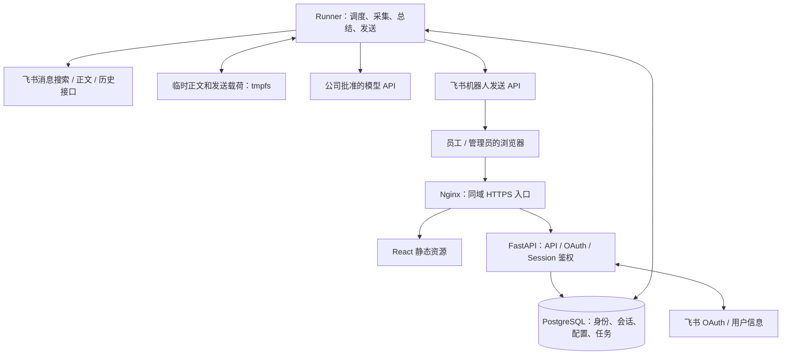
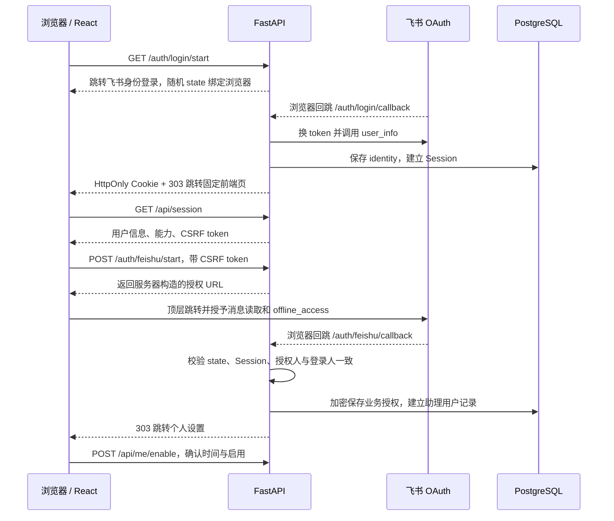

# 飞书个人会话总结助手技术设计

版本：v0.2｜日期：2026-09-30｜状态：编码基线草案，已完成文档一致性 review，飞书租户能力待 PoC  
对应需求：[需求文档 v0.1](./飞书个人会话总结助手-需求文档-v0.1.md)

修订说明：本轮统一为前端与后端两个仓库，部署配置归后端；补齐 Session、CSRF、数据权限、API 契约和前端部署；修正授权、调度及发送恢复规则。文件路径保持不变，避免已有链接失效。第 16 节记录 review 结论和编码门槛。

## 1. 方案结论

首版使用 **React + TypeScript + Vite + Ant Design 前端，Python 3.12 + FastAPI 后端，PostgreSQL 16 + Docker Compose 部署**，部署到一台公司云主机或持续运行的 Linux 服务器。通过一个飞书企业自建应用提供网页设置入口和机器人推送，至少服务 2 名独立授权的员工。

读取消息使用每位员工的 `user_access_token`；发送总结使用应用的 `tenant_access_token`。每日定时拉取，完成总结后由机器人私发本人。模型调用采用公司已批准的模型 API，通过适配层配置供应商和模型 ID。

首版采用前后端分离，后端保持模块化单体：前端和后端各一个仓库，部署配置放在后端 `deploy/`。前端产出含静态文件的 Nginx 镜像；后端产出一个镜像，分别运行 API 与后台任务进程。PostgreSQL 同时保存配置和持久化任务；无需 Redis、独立消息中间件、向量数据库或 Kubernetes。

最重要的前置条件不是模型效果，而是：**公司自建应用能否取得用户消息权限，以及这些权限能否实际读取员工之间的私聊、机器人不在群内的群消息和话题回复。** 文档存在边界描述不一致，必须先用两名员工实测。未通过时不能把项目降级为“仅总结机器人能看到的群聊”并视为满足需求。

本文明确区分：

- **文档已核实**：依据官方文档确认接口、字段或限制，附引用。
- **设计决定**：本项目为首版选择的实现方式和默认参数。
- **待实测**：官方说明不足、存在歧义，或需要本公司实际权限才能验证的能力。

## 2. 实现语言、仓库与技术栈

### 2.1 首版两个仓库

| 仓库 | 职责 | 技术栈 | 交付物 |
|---|---|---|---|
| `feishu-summary-web` | 员工设置、个人任务记录、管理员用户列表、任务历史与详情、前端路由和交互 | TypeScript、React、Vite、Ant Design、React Router；Vitest / Testing Library、Playwright | 静态文件 `dist/` 和包含该文件的 Nginx 镜像 |
| `feishu-summary-server` | OAuth、Session、权限、业务 API、数据库、调度、采集、模型总结、发送、运维与部署 | Python 3.12、FastAPI、Uvicorn、HTTPX、Pydantic、SQLAlchemy 2.x、Alembic、PostgreSQL 16；pytest、Ruff、类型检查 | 一个后端镜像，包含 API、runner、迁移入口；`deploy/` 发布配置 |

首版不设独立部署仓库、不使用 Jinja2、不拆员工前端与管理前端。飞书机器人属于后端集成模块；模型通过公司批准的 API 调用，不自建模型训练或推理服务。语言与数据库版本是兼容性基线，不表示最新版本；其余依赖在脚手架阶段验证兼容组合后锁定，提交完整锁文件。

前端使用 Node.js 的受支持 LTS 版本构建，版本须满足锁定 Vite 的要求并写入版本文件。生产环境只运行静态资源服务，不运行 Vite 开发服务器。[S15][S16]

### 2.2 模块边界

| 仓库目录 | 作用 |
|---|---|
| web：`src/pages/me`、`src/pages/admin` | 个人和管理页面，共享组件，不共享数据权限假设 |
| web：`src/api`、`src/auth`、`src/router` | 类型化 API、Session 引导、CSRF 请求头、401/403 处理、导航守卫 |
| server：`app/auth`、`app/settings`、`app/admin` | 身份、授权、配置、管理员查询和审计 |
| server：`app/jobs`、`app/collector`、`app/normalizer` | 调度、消息采集和规范化 |
| server：`app/summarizer`、`app/delivery` | 总结、来源校验、发送与幂等 |
| server：`app/integrations`、`app/db`、`alembic` | 飞书/模型客户端、数据库模型与迁移 |
| server：`deploy`、`docs` | 环境编排、备份恢复、需求与设计、PoC 记录 |

模型 prompt、输出 schema 与后端业务代码同版本发布。API 和 runner 共用 Python 包，但只由 runner 执行长任务，不能使用 Web 请求内的 BackgroundTasks 代替持久化任务。

### 2.3 部署对应关系

| 单元 | 镜像来源 | 职责 |
|---|---|---|
| `frontend` | web 仓库构建的 Nginx 镜像 | HTTPS 入口、静态文件、将 `/api/` 和 `/auth/` 转发到 api |
| `api` | server 镜像 | Session、OAuth、业务 API、健康检查 |
| `runner` | 与 api 相同的 server 镜像 digest | 调度、两个执行槽位、维护任务 |
| `migrate` | 与 api 相同的 server 镜像 digest | 发布时单次 Alembic 迁移，不常驻 |
| `postgres` | 官方镜像或公司数据库服务 | 配置、身份、任务和发送记录 |

首版通常是 4 个常驻容器和一个一次性迁移任务。服务器不需要 GPU。临时正文放 runner 的 tmpfs，数据库仅持久化元数据及加密凭证。需要公司 HTTPS 网关时，在 frontend 前增加网关或复用已有入口。

### 2.4 API 契约和联合发布

- 后端 Pydantic 请求/响应模型生成 OpenAPI，CI 导出 `contracts/openapi.json`；前端使用确定版本的 schema 生成 TypeScript 类型，记录契约版本，不靠手工复制字段维护接口。
- 前端 CI 做类型、组件及关键页面测试，构建前端镜像；后端 CI 做类型、单元、数据库测试，构建后端镜像。
- 后端 `deploy/releases/<版本>.yaml` 记录前端 digest、后端 digest、API 契约版本、数据库迁移版本。api、runner、migrate 必须使用同一个后端 digest。
- 部署 CI 使用该版本组合，先测试后生产。后端仓库中仅受保护的部署任务拥有生产发布权限，普通构建任务不拥有该权限。
- Nginx 环境配置、Compose、备份恢复脚本以 server 的 `deploy/` 为唯一来源，挂载至前端镜像；web 仓库保留本地开发代理配置与容器构建文件。
- 两个仓库互不复制源代码，不使用 `latest` 发布。破坏性 API 变更需要协调升级；优先通过新增字段实现兼容发布。

### 2.5 扩展边界

两人试点暂不引入 Redis、独立消息队列、向量库和 Kubernetes。增加 runner 副本前必须实现共享限流与载荷恢复；仅增加副本不要求拆仓。未来由独立运维团队管理多个项目和环境时，再评估拆出部署仓库。

FastAPI 和 Compose 均有官方容器部署文档。[S10][S11]

## 3. 技术架构



### 3.1 模块边界

| 模块 | 职责 |
|---|---|
| Identity / TokenService | OAuth、身份绑定、加密凭证、单用户串行刷新 |
| SettingsService | 时间、启停、下次执行时间、配置版本 |
| AdminQueryService | 管理员鉴权、公司范围内用户与任务查询、脱敏结果、访问审计 |
| Scheduler | 找到到期计划，创建唯一任务，处理短时停机补执行 |
| FeishuClient | 明确区分用户调用和机器人调用；限流、状态码、日志 ID |
| Collector | 三路查询、分页、去重、正文获取、上下文及覆盖检查 |
| Normalizer | 时间和身份统一，解析文本、富文本、提及及撤回状态 |
| Summarizer | 按会话分段、结构化抽取、汇总、引用校验 |
| DeliveryService | 固定收件人、渲染、分段、发送幂等、结果不确定处理 |
| Maintenance | 超时任务恢复、临时数据清理、凭证保活、运行指标 |

### 3.2 首版为何不依赖消息事件订阅

本需求每天运行一次，采用定时主动查询即可。普通 `im.message.receive_v1` 事件面向机器人收到的消息，不能作为“员工所有个人私聊”的消息源。[S8]

首版设置、暂停和立即总结均在网页完成；卡片里的设置按钮只打开网页，不提交飞书卡片交互回调。因此核心闭环不需要 WebSocket 长连接、消息事件 Webhook 或卡片回调地址。

后续若支持向机器人发送“暂停”等指令，可增加事件订阅及验签、去重，但其作用是控制入口，不能替代个人消息读取权限。

## 4. 飞书应用配置与依赖

### 4.1 应用形态与配置

创建公司内部的**企业自建应用**，同时开启网页应用和机器人能力：

1. 获取 App ID 与 App Secret，通过密钥管理注入服务。
2. 将网页首页配置为 `https://<服务域名>/`。
3. 配置本地登录回调 `/auth/login/callback` 和消息授权回调 `/auth/feishu/callback` 的完整 HTTPS 地址，与请求参数完全一致。
4. 申请用户身份权限及机器人发送权限，完成管理员审核、发布版本。
5. 首版飞书应用可用范围包括 A、B 及指定管理员；后端限定 `ALLOWED_TENANT_KEY`、`PILOT_OPEN_IDS` 和 `ADMIN_OPEN_IDS`，管理员身份登录不要求进入试点名单。
6. 确认刷新用户令牌的安全设置已开启；若后台不显示该开关，官方说明其默认开启。[S3]
7. 以两名员工分别完成授权及机器人送达测试。

管理员审批、应用发布、用户授权是不同步骤。后台申请权限不代表既有用户凭证已包含该权限；最终以 token 返回的 `scope` 为准。[S1][S2]

### 4.2 最小权限矩阵

| 权限 | 身份 | 用途 | 首版 |
|---|---|---|---|
| `offline_access` | 用户 | 返回刷新令牌，允许用户不在线时继续运行 | 必须 |
| `search:message` | 用户 | 按时间、私聊、发送人和 @本人搜索 | 必须 |
| `im:message:readonly` | 用户 | 获取消息正文 / 历史的基础读取权限 | 必须 |
| `im:message.p2p_msg:get_as_user` | 用户 | 员工个人私聊正文 | 必须 |
| `im:message.group_msg:get_as_user` | 用户 | 员工群聊正文 | 必须 |
| `im:message:send_as_bot` | 应用 | 机器人私发总结给员工 | 必须 |
| `im:chat:read` | 用户 | 若需要额外解析群名称等会话信息 | 可选，确认必要后再申请 |

身份通过用户信息接口返回的 `tenant_key` 和 `open_id` 绑定，不依赖邮箱或手机号，不要求额外申请员工 user ID。用户信息基本接口文档列出的接口权限为“无”，敏感字段有单独权限；只使用需要的基础字段。[S4]

不要将 `im:message.p2p_msg:readonly`（读取用户发给机器人的私聊）误当作员工之间私聊权限，也不要用群内 @机器人的权限实现群内 @员工。[S8]

### 4.3 接口清单

以下路径中的 `/open-apis` 均位于 `https://open.feishu.cn`，OAuth 主机单独列出。

| 接口 | 方法与地址 | 身份 | 说明 |
|---|---|---|---|
| 发起授权 | GET `https://accounts.feishu.cn/open-apis/authen/v1/authorize` | 浏览器跳转 | `response_type=code`、scope、redirect_uri、state |
| 换取 / 刷新令牌 | POST `https://accounts.feishu.cn/oauth/v3/token` | 服务端应用密钥 | 两种 grant_type，使用表单编码 |
| 当前用户 | GET `/open-apis/authen/v1/user_info` | 用户 | 取得 open_id 与 tenant_key |
| 应用令牌 | POST `/open-apis/auth/v3/tenant_access_token/internal` | App ID / Secret | 缓存到返回的到期时间前 |
| 消息搜索 | POST `/open-apis/im/v1/messages/search` | 用户 | 最大 30 条/页，文档标注 100 次/分钟 |
| 消息正文 | GET `/open-apis/im/v1/messages/{message_id}` | 用户 | 首版采用已核实的单条正文接口 |
| 会话 / 话题消息 | GET `/open-apis/im/v1/messages` | 用户 | 补充上下文；container 为 chat 或 thread |
| 私发总结 | POST `/open-apis/im/v1/messages?receive_id_type=open_id` | 应用 | 收件人固定为任务所属用户 |

依据：[S1]—[S7]、[S9]。批量正文接口作为后续优化，不作为本版能够达到目标的前提；使用前需额外核实其文档、权限、批量大小和错误行为。

## 5. 身份、授权与飞书交互流程

### 5.1 登录与消息授权分离

本地登录证明“是谁”，消息授权允许“后台读取哪些飞书数据”，两者分开。采用统一身份登录，管理员也不必先授权自己的消息。



- `/auth/login/start` 只发起身份登录，不主动申请消息读取与离线权限；飞书基础身份 scope 以 PoC 验证的最小集合为准。临时 token 在 user_info 后丢弃，不覆盖已有业务 token。即使飞书因历史授权返回更广 scopes，也不将登录 token 用于后台读取。
- 正常首次访问者必须在允许公司且属于试点或管理员名单。初始化名单前，由部署人员通过受限的一次性 `bootstrap-identify` OAuth 模式取得本应用 open_id；该模式仅回显经过公司校验的本人标识，不建立业务 Session、不授予业务能力，配好名单后关闭。禁止“第一个登录者自动管理员”。
- 授权码 5 分钟有效且单次使用；强制随机一次性 state、HTTPS、精确回调地址。[S1]
- state 至少 32 字节随机量，数据库保存哈希、purpose、浏览器随机绑定哈希、预期身份（授权流程）、到期时间与 consumed_at；回调以条件更新原子消费，拒绝重放。匿名绑定 Cookie 也设置 Secure、HttpOnly、SameSite=Lax。
- 个人消息授权需已有有效 Session、试点资格和 CSRF。回调必须仍属于发起 Session，并且 user_info 的 tenant_key/open_id 与预期身份一致，否则丢弃 token，不绑定其他账号。
- 后端持有 client_secret。PKCE 是否启用由第 12 节兼容性 PoC 决定，授权端 code_challenge 与 token 端 code_verifier 必须成对使用；首版服务端密钥流程仍受 state 和浏览器绑定保护。[S1][S2]
- 重新授权增加 auth_epoch，取消旧授权下尚未结束的任务；成功后不自动从 paused/disabled 改为 enabled。已 enabled 的用户重新授权后，从下一次未来计划恢复，不自动重发失败日报。
- 登录退出仅删除 Session，不取消每日任务；停用助理才删除业务凭证并取消任务。Session 过期时仍可以通过仅身份登录查看状态、暂停或停用，不要求先授予消息权限。

### 5.2 离线令牌刷新

访问令牌和刷新令牌的到期时间均根据返回字段计算，不能硬编码。`refresh_token` 每次刷新后立即失效，必须保存新的令牌；官方也规定授权满 365 天需重新授权，不承诺永久有效。[S2][S3]

每个用户的刷新流程：

1. 在专用数据库连接上取得用户级 session advisory lock（有获取超时，finally 解锁后再归还连接），重新读取凭证版本和用户状态；不在持有长事务期间调用网络。
2. access_token 距到期不足 5 分钟时执行刷新；成功后在事务中整体替换访问令牌、刷新令牌、有效期与实际 scopes。
3. 写入时检查 `auth_epoch` 未变化，避免停用或重新授权后旧刷新结果重新写回。
4. 释放锁。其他任务复用新凭证，不能同时消费同一个刷新令牌。
5. 失效、撤销或范围不足时进入 `needs_reauth`；停止个人读取，并在机器人仍可送达时提示重新授权。

刷新调用超时可能意味着旧 refresh_token 已被消费。不能无条件重试旧值；先检查是否已有新版本落库，无新版本且结果无法确认时要求重新授权。这是外部调用与本地事务无法原子提交的明确恢复边界。

维护任务每小时检查已启用用户的刷新凭证。每次收到凭证时保存 `refresh_issued_at` 和 `refresh_lifetime_seconds`，固定计算 `refresh_after = expires_at - min(24小时, 本次原始有效期×20%)`，到点刷新；不能使用不断缩短的“剩余有效期×20%”作为阈值。若供应商有效期短到不足以支持每小时检查，按实际 refresh_after 提前调度。暂停状态不主动保活，恢复前验证刷新能力；停用立即删除凭证。单次请求到期刷新和维护刷新共用锁。

### 5.3 个人设置与手动任务

设置页展示：当前用户、启用状态、每日北京时间、下次执行时间、授权状态、最近任务结果。

| 本服务接口 | 功能 |
|---|---|
| POST `/auth/feishu/start` | 当前登录用户发起消息授权，校验 CSRF |
| GET `/auth/feishu/callback` | 验证授权并绑定用户 |
| GET `/api/me/settings` | 读取个人配置 |
| PATCH `/api/me/settings` | 更新每日时间，校验 HH:mm，增加配置版本 |
| POST `/api/me/enable` | 校验授权后开启 |
| POST `/api/me/pause`、`/api/me/resume` | 暂停和恢复 |
| POST `/api/me/disable` | 停用、取消未发送任务、删除凭证 |
| POST `/api/me/runs` | 创建手动任务，接受请求幂等键，返回 202 与任务 ID |
| GET `/api/me/runs` | 本人最近任务列表，分页与时间筛选 |
| GET `/api/me/runs/{id}` | 返回本人任务状态和无正文统计 |

同一用户若已有非终态任务（含 queued/retry_wait），手动触发返回 409 与已有任务 ID。同一次手动操作携带 Idempotency-Key，重发相同键返回同一任务；不同键每用户每 5 分钟至多创建一次。暂停状态仅关闭自动任务，仍允许显式手动运行；未开启但已授权也可体验手动总结。disabled 或 needs_reauth 不能运行。页面不返回其他用户数据，不允许客户端指定推送对象。

### 5.4 管理员后台

#### 5.4.1 页面与导航

后台与个人页面属于同一个 React SPA。前端导航守卫根据 `/api/session` 控制入口和路由，后端对所有 `/api/admin` 请求独立鉴权。Nginx 返回 SPA 静态壳不代表授权，壳中不包含任何业务数据；真实数据只能通过已鉴权 API 获得。

| 页面 | 路径 | 功能 |
|---|---|---|
| 授权用户 | `/admin/users` | 查看已接入用户、授权与启用状态，搜索、筛选、分页 |
| 任务历史 | `/admin/runs` | 查看公司范围内任务，按用户、时间、执行/覆盖/送达状态筛选 |
| 任务详情 | `/admin/runs/{run_id}` | 查看阶段时间线、计数、错误与分段送达结果 |

`/admin` 默认跳转授权用户列表。用户行的“查看任务”链接跳转 `/admin/runs?user_id=...`。列表提供手动刷新；详情在非终态每 10 秒轮询一次，终态后停止。

首版不提供后台修改个人时间、代授权、导出消息、强制重跑或重发。管理员查看的是运行结果元数据，不是用户收到的总结正文。

#### 5.4.2 管理员身份与会话

- 使用第 5.1 节统一身份登录与第 5.5 节 Session，不另建管理员 OAuth 回调或重复登录系统。
- 管理员能力来自 `ALLOWED_TENANT_KEY + ADMIN_OPEN_IDS`，每个 API 请求重新检查后端配置，不能信任前端传入或 Session 中长期缓存的角色。配置变更通过受控重载/重启生效。
- 管理员登录只创建 identities/session，不自动创建助理用户、业务 token 或定时任务；管理员如也使用助理，需要另行进入试点并授权。
- 员工和管理员可为同一 identity；移除管理员配置立即在下一次生效的请求中拒绝后台权限。名单完全移除的身份，其本地 Session 也应拒绝使用。
- 个人停用不删除身份登录能力，仍能查看状态；离职/移出可用范围一旦通过 API 错误或运维名单变更检测到，撤销 Session、停用任务。无事件订阅时不承诺即时感知飞书侧变动。
- API 未登录 401、已登录非管理员 403、跨公司/不存在对象 404。前端遇到 401 导向统一身份登录，遇到 403 展示无权限。

#### 5.4.3 后台查询接口

| 接口 | 查询参数 / 输出 |
|---|---|
| GET `/api/admin/users` | `q`、`auth_status`、`enabled_status`、`page`、`page_size`；返回 total 与脱敏用户列表 |
| GET `/api/admin/runs` | `user_id`、`from`、`to`、`kind`、`execution_status`、`coverage_status`、`delivery_status`、分页；返回 total 与任务列表 |
| GET `/api/admin/runs/{run_id}` | 返回所属用户、统计窗口、阶段时间线、计数、重试、错误分类与发送分段元数据 |

全部查询强制带登录管理员的公司约束；user_id、run_id 即使存在也不能绕过公司范围。参数校验使用允许值枚举，page_size 默认 20、最大 100，首版查询区间最多 30 天。

默认任务时间范围为最近 7 天，以 `scheduled_at` 为筛选口径；手动任务该字段为触发时刻。界面日期以北京时间转换成 UTC 半开区间。任务按 `(scheduled_at DESC, id DESC)` 稳定排序，用户按 `(first_authorized_at DESC, id DESC)` 排序；采用参数化查询及服务端分页。

用户列表 DTO：`user_id, name, open_id, first_authorized_at, last_authorized_at, auth_status, auth_checked_at, enabled_status, daily_time, next_run_at, latest_run_result`。默认筛选有效授权且未停用的用户，可切换全部已接入用户。姓名不唯一时以 open_id 区分；open_id 可用于管理定位，不返回 token、邮箱或手机号。

任务列表 DTO：`run_id, user, kind, scheduled_at, started_at, finished_at, window_start, window_end, execution_status, coverage_status, delivery_status, duration_ms`。详情追加 `steps, collection_counts, coverage_issues, retry_count, safe_error, delivery_parts`。

序列化使用显式字段白名单，不直接返回 ORM 对象；任何后台接口都不读取正文临时目录、不解密用户 token、不请求飞书消息正文。界面展示已有安全错误模板，不展示可能包含消息片段或密钥的上游原始响应。

#### 5.4.4 授权状态与执行结果口径

授权与启用分开存储、分开展示：

| 状态维度 | 值 | 判定 |
|---|---|---|
| 授权状态 | `valid` | 最近检查权限完整，且访问凭证可用或刷新凭证尚可使用；不等于实时验证有效 |
| 授权状态 | `needs_reauth` | 必需 scope 缺失、刷新凭证过期，或已检测到授权失效/撤销 |
| 授权状态 | `removed` | 用户停用，本地凭证已删除 |
| 启用状态 | `not_enabled / enabled / paused / disabled` | 本应用内的助理配置状态，与授权状态独立 |

首次/最近授权时间仅在用户完成个人授权时更新，正常刷新不修改最近授权时间。`auth_checked_at` 记录最后一次实际授权、刷新或消息权限检查时间；读取列表时可根据本地到期时间判为 needs_reauth，但不能把列表访问当成一次权限验证。后台说明“基于最近检查，飞书侧撤销可能尚未同步”。

执行、覆盖、送达三维分开：例如“执行成功 + 部分覆盖 + 全部分段送达”“执行失败 + 覆盖未知 + 失败通知已送达”。任务执行失败不能因为失败提示发出成功就显示为成功。

送达聚合值采用 `not_started / sending / delivered / partial / failed / unknown`；报告发送与失败通知使用不同 purpose，分别展示。未开始执行、运行中或失败时 coverage 可为 `unknown`，不能默认显示 complete。无消息是成功采集后的 `no_data`，不是失败。阶段耗时取服务端记录，运行中的耗时展示“截至当前”。

#### 5.4.5 后台访问审计

记录管理员访问的 action、actor_open_id、tenant_key、目标用户/任务 ID、时间、是否允许及请求追踪 ID。列表访问只记筛选类别，不记录自由搜索文本或返回内容；401/403/跨公司访问同样记录，不包含凭证。

审计保留 30 天，纳入无正文运维记录。访问控制不能只依赖日志审计，拒绝必须发生在查询数据之前。

### 5.5 前端调用后端的鉴权与 API 契约

#### 5.5.1 Session 与 Cookie

后端生成至少 32 字节随机 Session ID，仅经 Cookie 传递；数据库存哈希及 identity_id、created_at、last_seen_at、expires_at、revoked_at、CSRF 随机值。禁止接受 URL 参数或请求体里的 session_id 作为登录证明。

```http
Set-Cookie: __Host-session=<随机不透明值>; Path=/; Secure; HttpOnly; SameSite=Lax; Max-Age=28800
```

不设置 Domain。登录成功、账号切换和授权后更新 Session ID，旧 Session 作废；绝对期限 8 小时、空闲 30 分钟。轮询不应无限延长空闲期限：只有明确前端用户交互后的会话活动调用更新 last_seen_at，后台状态轮询不更新。退出删除服务端 Session 并清理 Cookie。Session/cookie 和 CSRF token 不写日志、不进 localStorage。[S13]

身份登录过期与飞书读取授权过期独立：前者返回 401，后者在业务接口返回 409 `AUTHORIZATION_REQUIRED`，不要触发无限重新登录。后端不能仅凭 Cookie 存在就通过，必须查询有效 Session、公司和能力。

#### 5.5.2 API 访问矩阵

| 路由 | 所需条件 |
|---|---|
| `/auth/login/start`、登录回调 | 公开的身份登录流程；回调必验一次性 state/浏览器绑定，登录开始做 IP 限速 |
| `/auth/feishu/start` | Session + 试点资格 + CSRF，创建绑定身份的授权事务 |
| `/auth/feishu/callback` | 授权事务 state + 浏览器绑定 + 发起 Session + 相同飞书身份 |
| GET `/api/session` | Session；返回当前身份、能力、业务授权状态、CSRF token，不返回飞书凭证 |
| POST `/api/session/activity`、`/api/logout` | Session + CSRF；前者记录实际交互，后者注销 |
| `/api/me/*` | Session + 个人能力；对象 owner 来自 Session；运行/启用另验有效消息授权 |
| `/api/admin/*` | Session + 当前管理员白名单 + 公司范围 |
| `/health/live`、`/health/ready` | 仅容器网络探测，不经公网路由发布；不返回配置/密钥 |

首次未授权的试点用户，`GET /api/me/settings` 返回默认设置和 `authorization=not_connected`，不要求 user_tokens 或助理用户已存在。管理列表仅列已完成个人授权的人，不把纯身份登录者混入。

个人对象查询固定为 `WHERE id=:run_id AND user_id=:session_owner`；管理员查询显式 JOIN 公司范围。前端提交的 owner、tenant、is_admin 字段一律拒绝或忽略，不允许批量赋值到内部模型。对象不存在和越权统一 404，不泄露他人任务存在性。

#### 5.5.3 CSRF、同域与前端行为

前后端生产使用同一 HTTPS origin。浏览器 fetch 使用相对路径及 `credentials: same-origin`。修改操作 POST/PATCH/PUT/DELETE 必须携带 `X-CSRF-Token`，与服务端 Session 绑定值恒定时间比较；同时验证 Origin 精确等于 PUBLIC_BASE_URL，Origin 缺失时验证 Referer origin，二者均缺失则拒绝。OAuth GET 回调采用 state 防护，不要求 CSRF 请求头。[S14]

```typescript
const session = await fetch('/api/session', { credentials: 'same-origin' }).then(r => r.json());
await fetch('/api/me/settings', {
  method: 'PATCH', credentials: 'same-origin',
  headers: { 'Content-Type': 'application/json', 'X-CSRF-Token': session.data.csrf_token },
  body: JSON.stringify({ daily_time: '19:00' })
});
```

示例省略错误处理，实际统一 API client 处理 401/403/409/422/429，禁止把未知错误当成功。GET 不修改业务数据。生产不开放跨域凭证请求；CORS、路由守卫和按钮隐藏只是辅助，不能替代后端校验。

前端按 React 文本方式渲染用户输入及错误说明，不直接插入未清洗 HTML；不加载未知第三方脚本。HttpOnly 不能阻止 XSS 代用户发请求，因此仍需输出转义和内容安全策略。前端任何 `VITE_*` 配置均视为公开，只允许公开配置，不放模型或飞书密钥。

#### 5.5.4 响应契约与开发环境

API 成功结构为 `{data, request_id}`；失败结构为 `{error: {code, message, retryable, details?}, request_id}`，列表的 data 包含 items/total/page/page_size。details 只允许契约定义的安全字段，例如当前用户的 existing_run_id、参数校验问题或 retry_after_seconds，不透传异常栈。内部时间为 UTC，API 输出带时区 ISO 8601；前端按北京时间展示。422 表示参数错误，429 返回可用的重试时间提示。全部业务响应 `Cache-Control: no-store`。

本地开发通过 Vite 代理 `/api`、`/auth`，保证浏览器只访问一个开发 origin。真实 OAuth 联调使用已登记的 HTTPS 测试域名；Mock 登录仅限本地模式且使用假身份假数据，生产启动检测到 Mock 开关直接失败。自动化测试在 HTTPS 测试环境验证 Cookie/CSRF，不能只用关闭 Secure 的开发环境替代验收。

## 6. 消息采集设计

### 6.1 固定窗口与三路查询

任务创建时冻结 `window_start`、`window_end`，数据库使用 UTC `timestamptz`，展示和计划计算使用 Asia/Shanghai。窗口为 `[截止时间 - 24h, 截止时间)`。

三路独立查询，不能将条件全部放进同一个过滤器，否则变成条件交集：

| 路线 | filter 条件（均加入 time_range） |
|---|---|
| 私聊 | `chat_type=p2p`、`from_types=[user]` |
| 群内提及 | `chat_type=group`、`is_at_me=true`、`from_types=[user]` |
| 本人发出 | `from_ids=[当前用户open_id]`、`from_types=[user]` |

示例为群内提及请求；`page_size=30&user_id_type=open_id` 放在查询参数中：

```json
{
  "query": "",
  "filter": {
    "chat_type": "group",
    "is_at_me": true,
    "from_types": ["user"],
    "time_range": {
      "start_time": "2026-09-29T19:00:00+08:00",
      "end_time": "2026-09-30T19:00:00+08:00"
    }
  }
}
```

官方文档允许关键词为空，搜索提供分页和 `notice`，`is_at_me` 包含 @所有人。[S5] 结果取并集后按 `(tenant_key, open_id, run_id, message_id)` 去重，保留多种命中原因。只对“仅因群内提及命中”的消息确认正文 `mentions` 中存在本人，排除仅 @所有人；同一消息若也命中本人发出，则保留，不能因未 @本人被误删。

时间过滤在本地再做一次，以免接口边界的包含规则造成重复；历史接口时间参数为秒，正文时间可能为毫秒，搜索时间为 ISO 8601，适配层必须显式转换。[S5][S6]

### 6.2 分页、正文与上下文

1. 每路查询持续到 `has_more=false`；保存无正文的进度与计数，识别重复 page_token、防止死循环。
2. 对唯一消息 ID 调用正文接口，不把搜索 `display_info` 当正文。
3. 删除/撤回消息排除；已编辑内容使用本次获取版本；系统或机器人消息排除。
4. 以 chat_id、thread_id、parent_id 关联上下文。普通群历史只返回话题根消息，话题回复需 `container_id_type=thread` 单独读取；thread 查询不支持时间过滤，要在本地筛选。[S6]
5. 非话题消息可补充相邻约 10 分钟、最多 20 条作为上下文，超出时按需扩展；这是上下文预算，不得用于截断本应采集的命中消息。
6. 长话题按页读取；如因预算无法展开完整上下文，记录 `context_incomplete`，摘要中不下依赖缺失背景的确定结论。
7. 上下文标记 `context_only=true`；仅允许补充截止时间之前的上下文，不能把采集延迟期间新发送的消息引入原窗口。窗口开始前的上下文不进入“本日新增”统计。正文编辑使用读取时版本，不能承诺还原截止时历史版本。

名称解析不能成为核心链路的硬依赖：自身名称来自授权信息，对方或群名优先取可访问元数据；额外接口失败时使用身份标识、会话标识和时间定位，不猜姓名。

### 6.3 结果不全与搜索索引延迟

搜索接口是检索能力，文档没有承诺严格的消息全量导出或索引延迟上限。因此：

- 检查 `notice`，对结果不全尝试将窗口二分，直到最小 5 分钟；拆分仍不完整就标记缺口，不能静默截断。
- 对已发现的会话可使用历史接口核对窗口消息，但这不能发现完全未被搜索返回的新会话，不得视为全量保证。
- 在计划时间 T 开始预检与采集，T+60 秒后再次搜索末尾 10 分钟，保持截止时间 T 不变，合并后再生成。该策略降低尾部索引延迟风险，不构成完整性保证。
- 实测 0、1、3、5 分钟后的新消息可见性，确定 60 秒尾部回查是否足够；必要时调整等待时间并同步 10 分钟送达目标。
- 仅当三路分页结束、无已知搜索缺口、正文及解析情况检查完成，才展示“本次可访问范围采集完成”。未知遗漏率无法从 API 自证，通过人工构造测试核验。

### 6.4 覆盖数据

每份任务记录 `search_count_by_route`、`unique_count`、`parsed_count`、`unparsed_count`、`recalled_count`、`body_failed_count`、`context_incomplete_count`、`search_incomplete`、`notice_codes`、`summary_incomplete` 和 `omitted_count`。唯一计数排除尾部回查重复项，明确区分候选数与最终符合规则数。

非文本未解析、任意正文读取失败或上下文不足均反映到覆盖说明。没有结果且三路查询均成功才是“无消息”；某一路失败不能归类为“无消息”。三路全部失败或已知非空但一条正文都无法读取时，任务失败；某一路失败但存在有效正文时允许生成明确标识的部分总结。只有未解析附件时发送类型与缺失说明，不编造实质摘要。模型处理超预算或分块失败也必须令 coverage=partial，并标注未处理范围，不能只检查采集结果。

## 7. 总结生成与输出

### 7.1 处理流程

```text
正文规范化 → 按会话/话题排序分块 → 各块抽取事实与行动项
        → 合并同一话题 → 生成总览 → 程序校验引用及范围 → 渲染飞书消息
```

不将全部消息直接拼进一个超长 prompt。每个块按模型 token 预算切分，输入预留至少 30% 的上下文空间给指令和输出；具体块大小依据选定模型测试。

每块输出结构化结果，例如：

```json
{
  "topics": [{"title": "发布安排", "summary": "...", "source_ids": ["m_12"]}],
  "decisions": [{"text": "...", "source_ids": ["m_12"], "certainty": "explicit"}],
  "actions": [{"text": "...", "owner": null, "deadline": null, "source_ids": ["m_15"]}]
}
```

`m_12` 是本任务内的短引用 ID，映射到真实消息。模型不生成飞书 URL、收件人 ID 或权限参数；程序根据已验证来源生成跳转信息。跳转 URL 规则需在 PoC 验证，未验证前使用会话、时间、消息标识的定位信息。

### 7.2 校验与降级

- 所有 source_ids 必须属于本用户本任务的消息集合；无来源的重要结论删除或要求重生成。
- Pydantic 校验输出结构；格式错误最多修复一次，仍失败则任务生成失败。
- 责任人和截止时间只接受明确来源；“没有检索到回复”不能转成“尚未处理”。
- 程序校验不能证明摘要语义完全正确；两人试点须人工核对关键决定和行动项。
- 模型只处理素材，不授予工具执行能力；消息中的指令不允许改变系统规则或发送对象。
- 各块均处理后才汇总。超预算时分批或明确部分完成，不静默丢掉末尾内容。
- 不提供未批准供应商的自动 fallback，避免失败重试时将聊天发送到不同数据处理方。

### 7.3 飞书输出

优先发送静态卡片，包含统计区间、覆盖提示、主题、行动项、来源，以及打开设置页的链接。卡片/富文本请求体上限为 30 KB，按实际 UTF-8 序列化字节数校验，内部阈值取 24 KB 留出结构开销，超出后按主题分段并编号。[S7]

每段固定正文后再进入发送阶段，分段顺序发送。静态卡片渲染确定失败时可在未发送前改用文本；已发送部分后不能把整份报告换格式重发。授权失败等运行提示单独使用固定模板，也遵循发送防重。

## 8. 数据模型与隔离

| 表 / 存储 | 核心字段 | 约束与用途 |
|---|---|---|
| identities | id、tenant_key、open_id、name、access_status、created_at | UNIQUE(tenant_key, open_id)；所有允许的登录身份，含纯管理员；name 不鉴权 |
| users | id、identity_id、auth_epoch、first_authorized_at、last_authorized_at、auth_status、auth_checked_at、auth_error_code、reauth_notice_epoch | identity_id 唯一外键；仅个人助理已授权用户；公司与 open_id 通过 identity 关联；失效提示按授权周期防重 |
| user_tokens | user_id、access_cipher、refresh_cipher、expires_at、refresh_expires_at、refresh_issued_at、refresh_lifetime_seconds、refresh_after、scopes、version、key_id | user_id 唯一；字段加密；禁止日志输出 |
| user_settings | user_id、enabled_status、daily_time、timezone、next_run_at、config_version | enabled_status 枚举 not_enabled/enabled/paused/disabled，避免与布尔 enabled 并存 |
| oauth_states | state_hash、purpose、browser_binding_hash、expected_identity_id、initiating_session_hash、expires_at、consumed_at | state 原子单次消费，个人授权要求预期身份及发起 Session |
| sessions | session_hash、identity_id、csrf_token、created_at、last_seen_at、expires_at、revoked_at | FK 指向 identities；Session 不保存角色快照或飞书凭证 |
| summary_runs | id、user_id、kind、scheduled_at、started_at、finished_at、window_start/end、state、coverage、config_version、auth_epoch、lease、fencing_version、attempt、cancel_requested_at、error_code | 仅 scheduled 类型唯一键 (user_id, scheduled_at)；窗口不可变；保留 missed/cancelled 记录 |
| manual_requests | user_id、idempotency_key_hash、request_hash、run_id、expires_at | UNIQUE(user_id, idempotency_key_hash)，保留24小时；同键不同请求409 |
| run_steps | run_id、stage、状态、started_at、finished_at、计数、attempt_count、retry_at、耗时 | 不保存正文、搜索片段或带敏感内容的原始错误响应 |
| delivery_parts | run_id、purpose、part_no、uuid、payload_hash、state、first_attempt_at、sent_at、message_id | UNIQUE(run_id, purpose, part_no)，uuid 唯一；purpose 区分 report / failure_notice |
| user_execution_locks | user_id、owner、lease_until、fencing_version | 确保同一用户只有一个活动任务 |
| admin_access_audit | actor_open_id、tenant_key、action、target_type/id、allowed、created_at、request_id | 记录后台访问及拒绝，不保存正文、token 或完整返回数据 |
| 临时目录 tmpfs | run_id 下的规范化正文、摘要、固定发送载荷 | 非持久化；进程重建后可丢失；不进入数据库或备份 |

所有任务经 users.identity_id 关联 identities 的 tenant_key/open_id，跨表使用外键。所有个人接口必须从服务端 session 推导 owner；查询单个 run 时也必须限定 owner，不能只按 run_id 查询后返回。管理员查询使用独立服务方法，在管理员鉴权后限定公司范围，不能复用一个允许客户端关闭 owner 校验的个人查询接口。

后台查询增加索引：identities(tenant_key, open_id)、users(auth_status, identity_id)、summary_runs(user_id, scheduled_at DESC, id DESC)、summary_runs(scheduled_at DESC, id DESC)、run_steps(run_id)、admin_access_audit(tenant_key, created_at DESC)。列表最近任务使用一次批量关联或窗口查询，避免逐用户额外查询；过期的运行记录按 30 天清理，界面明确显示保留范围。

共享群里的同一消息仍按用户分别授权获取与缓存，首版不做跨用户正文缓存。机器人发消息时，收件人仅从该任务的 owner 读取。

调度、任务领取及每次外部读取/发送前，也要验证 identity.access_status、当前试点名单、auth_epoch 和取消标记。配置移出试点后不只拦截浏览器请求，还必须停止后台任务；管理员身份并不授予替他人读取正文的能力。

运行程序使用非数据库超级用户；迁移账号与运行账号分离。数据库管理员及服务器管理员仍属于基础设施信任边界，产品不承诺对这些管理员实现端到端不可见。

## 9. 调度、任务状态和幂等

### 9.1 计划生成

runner 每 15 秒扫描 `enabled_status=enabled AND next_run_at<=now()`：

1. 事务内锁定配置行，以当前配置枚举从 next_run_at 到当前的应执行时点（最多展开保留期内30天，更早记录运维缺口数）。
2. 超过2小时的时点分别记录 missed；最近时点若延迟不超过2小时则插入 queued，用户授权已知失效则直接记 needs_reauth。唯一约束阻止重复创建，不因先遇到数天前的计划就跳过今天仍可补执行的计划。
3. 将 next_run_at 更新为下一次未来的北京时间计划，在同一事务提交。

配置修改也锁定同一行，增加 config_version，并取消尚未执行的旧计划任务。正在执行的旧任务保留原窗口；暂停/停用则为当前所有非终态任务增加取消标记，并在外部请求前和发送前检查。暂停之后新建的显式手动任务允许运行，通过 created_at/cancel_requested_at 区分，不能简单因 paused 拦截所有发送。

### 9.2 执行与恢复

```text
queued → collecting → summarizing → ready_to_send → sending → succeeded
           │              │               │             │
           └→ retry_wait  └→ failed        └→ cancelled  └→ delivery_unknown
           └→ needs_reauth
```

覆盖质量采用独立字段 `unknown / complete / partial / no_data`，不与发送状态混淆。missed 和 cancelled 为独立终态；失败任务可有独立的失败通知发送记录，后台不得把通知送达视为总结成功。

worker 用 `FOR UPDATE SKIP LOCKED` 领取任务，短事务写 lease 后立即释放数据库锁，再执行网络调用。PostgreSQL 文档说明 SKIP LOCKED 可用于队列式竞争，但不能作为普通查询的一致性保障。[S12]

手动创建与计划创建均在事务内锁同一 users 行，再依次访问 user_settings、summary_runs、user_execution_locks，统一锁顺序。手动请求在锁内检查幂等键、非终态任务和频控，再插入任务；不能以“先查询后无锁插入”防重复。领取时先选择候选用户再按同一顺序锁定，遇到已锁对象跳过，避免先锁任务再锁用户形成死锁。

领取任务和用户租约需在同一短事务内完成，所有并发入口遵循同一锁顺序。设计默认 lease=120 秒，每 20 秒续租。每次写状态或发送前验证 fencing_version，失去租约的旧执行器不得继续提交。每次续租失败立即停止新外部调用，等待中的请求取消；已在途的外部发送仍存在竞态，最终依靠固定 uuid 降低重复风险，不能声称 fencing 能撤销飞书请求。用户级租约避免同一人的手动和定时任务同时执行；定时任务可排队等待，不因手动执行而丢失。

runner 重启后：从未尝试任何发送的任务可清理未使用的 delivery_parts，再采集原窗口并重新总结，更新 payload_hash；任何分段已尝试发送的任务按下一节处理，不能直接生成另一份内容复用旧 uuid。相同进程内恢复如保留载荷则优先继续固定载荷。

### 9.3 发送幂等与不确定结果

本地任务表、delivery_parts 与飞书 uuid 共同防重。飞书相同 uuid **1 小时内**至多成功发送一条消息；这不是永久的 exactly-once 保证。[S7]

- 每段内容冻结后生成确定性 UUID（例如 UUIDv5(run_id + purpose + part_no)，长度不超过 50），记录 payload_hash 和固定收件人；报告与失败通知使用不同 purpose。
- 调用前提交 sending 与 first_attempt_at；成功后记录飞书 message_id。
- 明确失败且未投递时按分类重试；网络超时或连接中断视为“可能已成功”。
- 载荷仍在、任务未超过总期限且距首次尝试小于 50 分钟时，可使用相同 uuid、相同正文重试；实际取更早截止，不能用去重窗口延长任务期限。
- 超过去重窗口，或重启导致原载荷丢失且发送结果未知时，标记 delivery_unknown，停止自动重发；若已取得 message_id 可核对，否则不假设平台支持按 uuid 查询。
- 已成功的分段不重发；中途未知则暂停剩余分段，设置页提示“部分送达 / 结果待确认”。
- 重启丢失载荷但发送结果均明确时：若所有段已成功，补记 succeeded；若只有部分成功，记 failed + delivery=partial（PAYLOAD_LOST），未发送部分不再生成；若存在任何结果不确定的段，记 delivery_unknown。这三个分支不得混为重新执行全任务。
- delivery_unknown 为终态，首版不自动重发也不提供管理员重发按钮；用户可核对飞书记录并显式创建新的手动任务，界面提示这会产生一份新总结。

两人试点接受极少数不确定结果需要人工核对，优先避免重复推送。暂停/停用不能撤销已经提交给飞书的在途请求，但发送前必须再检查状态，并记录这种竞态的结果。

### 9.4 重试规则

临时网络错误、明确可重试的服务错误及限流，最多自动重试 3 次；退避基准可取 5、20、60 秒并增加随机抖动，有平台等待指示时优先遵守。次数按同一外部操作计算（首次+最多3次重试）；每个任务另设30分钟总执行期限，超过10分钟提示超时但不立即丢弃，超过30分钟未完成则安全结束，未知发送记 delivery_unknown。读操作重试不得叠加多层装饰器无限放大，达到上限记录失败/部分覆盖。发送和刷新令牌的特殊规则优先于通用重试。所有 HTTP 调用设置连接及总超时，模型单次建议120秒，不能无限挂起。

任务执行期限从首次 started_at 计算，重启或 retry_wait 不重置；队列等待时间单独计量，并纳入计划到送达的性能统计。用户长期授权失效时可按每日计划记 needs_reauth，但同一授权失效周期只发一次重新授权提示，避免每天重复打扰；再次成功授权后重置提示状态。

## 10. 限流、容量和模型费用

官方文档标注：搜索 100 次/分钟，正文与历史 1000 次/分钟且 50 次/秒；同一用户发送消息限制 5 QPS。[S5][S6][S7]

平台限流的实际计数维度需在本租户确认。首版保守按全应用共享预算：搜索 60 次/分钟；正文与历史合计 300 次/分钟、瞬时最多 5 次/秒；单用户推送最多 1 次/秒。单个 runner 持有共享限流器，两个用户公平轮转，单用户最多占 2 个 HTTP 在途请求。以后扩 runner 时需迁移为跨进程限流。

估算方法：设每人三路去重前命中总数为 R，去重后为 M，则搜索次数约为各路 `ceil(数量/30)` 之和，正文约为 M 次，另加上下文和尾部回查。两人各 1000 条时，正文至少约 2000 次；按每分钟 300 次约需 6.7 分钟，再加搜索、上下文和模型耗时。

因此需求中的“95% 在 10 分钟内完成”是需验证的目标，不能仅凭两人数量就承诺。若测试不达标，优先核实批量读取接口或安全提高配额利用率，其次考虑提前增量采集；不得通过少取消息来达标。

模型成本按实际 token 记录：`输入token×输入单价 + 输出token×输出单价`，叠加分段、汇总与重试。每次任务设置可配置 token 上限，超限标记部分完成或失败，不静默截断。本阶段不提供未经询价的固定月费；主要费用项是主机、数据库存储、备份、模型调用及已有企业服务额度。

## 11. 部署方案

### 11.1 推荐首版部署

**一台公司云上 Linux 虚拟机，Docker Compose 常驻运行；开发机只用于开发与调试。** 优先复用公司的域名、HTTPS 网关和模型出口。没有现成环境时，可选公司允许使用的国内云主机，具体云厂商不影响代码结构。

试点初始资源建议为 **2 vCPU、4 GB 内存、40 GB SSD**，模型在远端运行，本机不需要 GPU。这是起始配置，应根据实际内存、数据库和 tmpfs 峰值调整。

| 容器 | 数量 | 作用 |
|---|---:|---|
| frontend | 1 | Nginx 提供 React 静态文件、HTTPS、同域反向代理 |
| api | 1 | OAuth、Session、个人与管理 API |
| runner | 1 | 调度、两个任务槽位、限流与维护任务 |
| postgres | 1 | 持久化数据卷；可换成已有托管数据库 |

api 与 runner 使用同一个后端镜像，不同命令：`uvicorn app.main:app` 与 `python -m app.runner`。迁移任务使用相同后端镜像单次运行。配置 restart policy、健康检查、非 root 业务进程和资源限制，数据库及 API 端口不向公网暴露。

单机部署不承诺高可用；已有公司容器平台可以沿用镜像，runner 仍保持单副本。4 GB 内存是试点起始配置，前端构建在 CI 完成，不在生产主机同时跑 Node 构建。

### 11.2 网络与域名

- 员工设备需能访问 HTTPS 设置页面与 OAuth 回调。OAuth 回调由员工浏览器跳转，并非消息 Webhook。
- 服务器需出站访问 `accounts.feishu.cn`、`open.feishu.cn` 及选定模型 API；允许 DNS 和时间同步。
- 首版无飞书事件 Webhook，因此不要求飞书服务器主动进入业务网。内网页面可行的前提是所有试点员工设备都能访问；需覆盖手机时优先使用公司可外部访问的 HTTPS 入口。
- 生产配置固定域名与证书，不采用开发隧道作为长期运行入口。

### 11.2.1 同域路由与缓存

Nginx 路由顺序：`/api/`、`/auth/` 转发至 `api:8000` 且保留原路径；`/health/` 外部拒绝；`/assets/` 只查静态文件，不存在则404；其他页面路由回落到 index.html，支持 `/admin/runs/<id>` 刷新。未知 `/api` 路径必须保留 JSON 404，不能回落成 HTML。

只信任内部网关设置的 Forwarded/X-Forwarded 头，后端限制可信代理与 Host。API、OAuth 回调不缓存，访问日志省略 code/state 和 Cookie；前端 index.html 短缓存或 no-cache，带内容哈希的 assets 可长期缓存。所有鉴权仍在 API，静态 SPA 壳公开可下载不暴露业务数据。

### 11.3 配置与密钥

```text
APP_ENV=production
PUBLIC_BASE_URL=https://<服务域名>
FEISHU_APP_ID=<应用ID>
ALLOWED_TENANT_KEY=<公司标识>
ADMIN_OPEN_IDS=<本应用管理员open_id列表，默认空>
PILOT_OPEN_IDS=<允许使用个人助理的open_id列表，默认空>
BOOTSTRAP_IDENTIFY_ENABLED=false
MOCK_AUTH_ENABLED=false
DATABASE_URL=<数据库连接串，通过密钥注入>
FEISHU_APP_SECRET_FILE=<挂载密钥路径>
TOKEN_ENCRYPTION_KEY_FILE=<挂载密钥路径>
MODEL_BASE_URL=<已批准服务地址>
MODEL_ID=<已验证模型ID>
MODEL_API_KEY_FILE=<挂载密钥路径>
TZ=Asia/Shanghai
WORKER_CONCURRENCY=2
```

密钥通过公司 Secret 管理或仅 root 可读文件挂载，不提交仓库、不写进镜像。字段加密采用成熟库实现 AES-GCM，随机 nonce，附加认证数据绑定 user_id 与字段用途；保存 key_id 支持轮换。

### 11.4 临时数据、备份与恢复

- runner 的 `/run/summary-data` 使用 tmpfs，初始上限 512 MB、仅 runner 可读；首版主机关闭 swap、runner 禁止 core dump，避免正文进入磁盘及崩溃转储。
- 每次任务结束后尽快删除正文和发送载荷，最迟 24 小时内；未终结任务设置绝对清理截止，超过截止进入失败或不确定状态，不能无限续期。
- 日志、追踪、模型 SDK 均关闭 prompt/response 原文记录；只保留必要计数和错误分类。
- PostgreSQL 保存加密凭证和无正文元数据，不保存正文或摘要。每日加密逻辑备份采用显式表白名单，只包含 identities、users 和 user_settings 的必要配置字段及 schema 版本；排除凭证、会话、OAuth state、运行历史与发送记录。恢复后将 auth_status 重置为 needs_reauth，不信任备份中的有效授权标记，用户需要重新授权。
- 不为该服务配置含正文缓存的磁盘快照；模型供应商自身数据保留规则需在接入前确认，服务端清理不代表供应商也已删除。
- 备份放在独立存储，保留 7 天；无正文运行记录在线保留30天；本版备份只保留配置及文档列明的非运行资料，不备份 summary_runs、run_steps、delivery_parts、manual_requests 或访问审计，避免把30天保留期延长到37天。灾难恢复可能丢失运行历史，需接受此试点边界。
- 从备份恢复时默认关闭自动发送，将原 enabled 用户改为 paused，废弃备份中的 next_run_at；重新授权并显式恢复后，从下一次未来时点开始，不补发恢复前的报告。由于运行历史不在备份中，不能声称能还原此前逐任务状态。首次演练目标为2小时内恢复服务，允许最多丢失24小时配置变更及灾难前运行历史；需演练验证。

### 11.5 发布流程与目录

1. 前后端分别构建并测试，后端 `deploy/` 固定两个镜像 digest 及契约、迁移版本。
2. 测试环境运行同一版本组合，验证身份登录、个人授权、CSRF、消息读取、私发、管理员及用户隔离。
3. 生产进入短维护窗口：runner 停止领新任务、排空并记录恢复状态，API 阻止新增任务和配置写入，再备份允许的配置数据。先排空后迁移，避免旧进程使用变更后的表。
4. 使用目标后端镜像单次运行 Alembic；失败停止发布，不启动不兼容的新进程。优先采用可向后兼容的迁移，禁止自动破坏性降级数据库。
5. 启动目标 API 与 runner，再切换兼容前端；检查健康、身份登录、权限、心跳、清理后解除维护模式。
6. 回滚使用记录的前后端版本组合并验证 schema 兼容，保留现有任务和发送记录，不清表重启。

```text
feishu-summary-web/
  src/
    pages/me/ pages/admin/
    api/ auth/ router/ components/
  tests/                       # 单元、组件与端到端测试
  contracts/                   # 选定后端OpenAPI版本与生成类型
  Dockerfile                   # Node构建，Nginx运行
  package.json
  package-lock.json
  vite.config.ts               # 本地同域代理

feishu-summary-server/
  app/
    main.py runner.py
    auth/ settings/ admin/
    jobs/ collector/ normalizer/
    summarizer/ delivery/
    integrations/ db/
  alembic/
  contracts/openapi.json
  tests/ docs/
  Dockerfile                   # API、runner、migrate共用
  pyproject.toml
  requirements.lock
  deploy/
    compose.yaml
    environments/ releases/ nginx/
    scripts/                   # 发布、备份、恢复
    docs/                      # 运维手册
  .env.example                 # 仅占位符
```

当前文档将归入 server/docs，保留单一来源。上述目录、仓库和流水线是设计，尚未创建。

## 12. 飞书依赖与技术卡点

| 编号 / 等级 | 卡点 | 当前证据与影响 | 验证办法 / 失败处理 |
|---|---|---|---|
| K01 / 阻断 | 用户消息权限能否申请并发布 | 文档存在 scope 不代表本公司应用一定能开通 | 管理员实际申请；若不可用，向飞书确认开放条件，不能用应用 token 代替 |
| K02 / 阻断 | 员工私聊、机器人不在群内的正文读取 | 正文/历史文档同时写用户身份权限与“机器人须在群内” | 两账号私聊、机器人在/不在群内分别测；搜索成功但正文失败也算未通过 |
| K03 / 阻断 | 每日无人值守授权 | 需 offline_access；刷新令牌单次轮换 | 实测访问令牌过期后自动刷新、两任务竞争、刷新响应丢失；缺少刷新令牌不允许开启每日计划 |
| K04 / 高 | 搜索完整性与索引延迟 | 可返回结果不全 notice，无严格全量承诺 | 空关键词、多页、短窗口拆分、刚发送消息、首次出现的私聊逐项核对 |
| K05 / 高 | 话题回复覆盖 | chat 历史不等于话题全部消息 | 对根消息、@回复、本人回复构造测试；不完整明确标记，必达测试缺失则不验收 |
| K06 / 高 | @本人和 @所有人混合 | is_at_me 包含 @所有人 | 正文 mentions 二次过滤；测试含两种提及、姓名文本和富文本提及 |
| K07 / 高 | 推送可用范围及用户屏蔽 | 机器人只能向允许范围用户推送，用户可停止接收 | 两人都验证；送达失败在设置页显示，不能只依赖飞书通知告知失败 |
| K08 / 高 | 发送去重仅 1 小时 | 超时、重启、分段可能产生不确定结果 | 固定 uuid + 本地发送记录；窗口外不盲重发，见第 9 节 |
| K09 / 中 | 消息链接和名称解析 | 不保证所有消息类型都有可用跳转规则 | 桌面/手机分别点击验证；失败使用需求允许的定位信息 |
| K10 / 高 | 搜索与正文配额 | 两人高消息量仍可能超过 10 分钟目标 | 实测共享限流和并发；保持完整性优先，达不到就优化或显式修订性能目标 |
| K11 / 中 | 保密会话、撤回、特殊类型 | 部分会话不可读取；非文本未解析 | 标注不可访问/未解析；不能把这些失败计为无消息 |
| K12 / 中 | OAuth 文档版本差异 | v2 已标记历史，授权文档仍有 PKCE 兼容提示 | 采用 v3 服务端密钥流程，单独验证 PKCE 后再启用 |

前置验证所需配合：公司飞书应用管理员、两名试点员工、一组内部测试会话、可用 HTTPS 域名、允许处理聊天数据的模型服务账号。本文没有申请权限、调用真实员工消息或部署任何服务。

## 13. 验证与开发计划

### 13.1 第一阶段：PoC，不先做完整界面

按下面顺序出具一份脱敏验证记录，保存 API 名称、身份类型、实际 scopes、消息类型、结果码与数量，不保存员工原文：

1. 两人各自 OAuth，user_info 身份正确，取得刷新令牌。
2. 双方之间私聊收发均可检索及读取。
3. 同一内部群，在机器人不在群时读取 @A、A 发言和话题回复；再用机器人在群对照。
4. 多页、@所有人排除、撤回、编辑、秒/毫秒边界、保密消息错误。
5. token 到期刷新及机器人分别私发 A、B。
6. 搜索尾部延迟、1000 条消息容量、模型耗时和卡片大小。

K01—K03 未通过前，可编写前后端脚手架、Mock 页面、鉴权基础、解析和状态机测试，但不认为核心业务可用，也不扩大完整业务实现投入。消息权限与能力是 PoC 验证项，不靠文档 review 判定通过。

### 13.2 第二阶段：闭环实现

依次实现数据库与授权、个人设置、持久化调度、消息采集、模型总结、发送防重、管理员后台、清理与部署。管理员后台包含用户列表、任务列表与详情，使用已记录的运行元数据。验证达到需求中的 F01—F11。

### 13.3 第三阶段：验收与 7 天试点

| 检查层 | 必测内容 |
|---|---|
| 单元测试 | 三路并集、直接 @过滤、时间边界、文本解析、来源验证、下次计划计算 |
| 数据库集成 | 两用户隔离、唯一任务、并发领取、租约失效、配置修改与调度竞争 |
| 外部故障模拟 | 429、5xx、过期 token、refresh 超时、正文部分失败、模型格式错误 |
| 发送恢复 | API 成功但本地未落库、未知响应、跨 1 小时、分段中断、恢复旧备份 |
| 实际飞书联调 | 双用户完整覆盖、真实授权、私发本人、设置页与来源定位的桌面/手机可用性 |
| 身份与鉴权 | 无Cookie、伪造/到期Session、旧Session重放、CSRF缺失/错误、跨站写入、OAuth state重放、授权账号错配全部拒绝；停止助理后仍可仅身份登录 |
| 名单与运行权限 | bootstrap默认关闭且不授予业务权限；移出试点同时拦截API与后台执行；仅管理员登录不请求消息权限 |
| 管理员后台 | 普通用户前端路由守卫提示且真实API拒绝；管理员跨公司访问拒绝；状态筛选准确、审计齐全、无正文凭证；纯管理员Session不依赖users记录 |
| 连续试点 | 与需求 A01—A20 逐项对应，7 天记录全部运行成功率及耗时，不夸大 14 次样本的 P95 稳定性 |

开发工作量粗估：熟悉 Python 和飞书接口的一名工程师，在权限和资源到位后，PoC 1—2 人日，后端闭环 4—6 人日，独立前端页面与前后端鉴权联调 3—5 人日，可靠性与部署 2—3 人日；之后 7 个自然日试点。权限审批、接口卡点处理和模型效果调优不包含在该估算中。

## 14. 运维指标与扩展条件

首版记录：计划延迟、各阶段耗时、消息数量、分页数、搜索不全次数、读取错误、token 刷新失败、模型 token、发送成功/失败/未知、runner 心跳、临时数据清理结果。

设置 runner 心跳超过 2 分钟、应执行任务超过 10 分钟未结束、出现 delivery_unknown、清理连续失败等运维提示；具体告警渠道沿用公司已有设施，日志不携带正文。

扩展到更多员工前，先根据实际峰值重新计算配额与模型成本。若增加多个 runner，必须加入跨进程限流和共享临时载荷方案；若追求高可用，迁移至托管数据库和公司容器平台；若搜索完整性不足，评估增量采集，但不能假设机器人事件可以补齐员工私聊。

## 15. 官方资料与核实日期

以下资料于 2026-09-30 读取。官方页面可有滞后或变更，租户级权限、消息覆盖和容量仍以 PoC 为准。

- [S1 获取授权码](https://open.feishu.cn/document/authentication-management/access-token/obtain-oauth-code.md)
- [S2 获取 user_access_token v3](https://open.feishu.cn/document/uAjLw4CM/ukTMukTMukTM/authentication-management/access-token/get-user-access-token-v3.md)
- [S3 刷新 user_access_token v3](https://open.feishu.cn/document/uAjLw4CM/ukTMukTMukTM/authentication-management/access-token/refresh-user-access-token-v3.md)
- [S4 获取用户信息](https://open.feishu.cn/document/server-docs/authentication-management/login-state-management/get.md)
- [S5 新消息搜索接口](https://open.larkoffice.com/document/uAjLw4CM/ukTMukTMukTM/reference/im-v1/message/search.md)
- [S6 获取会话历史消息](https://open.feishu.cn/document/server-docs/im-v1/message/list.md)；[获取指定消息内容](https://open.feishu.cn/document/server-docs/im-v1/message/get.md)
- [S7 发送消息](https://open.feishu.cn/document/server-docs/im-v1/message/create.md)
- [S8 接收消息事件](https://open.feishu.cn/document/server-docs/im-v1/message/events/receive.md)
- [S9 自建应用获取 tenant_access_token](https://open.feishu.cn/document/server-docs/authentication-management/access-token/tenant_access_token_internal.md)
- [S10 FastAPI 容器部署](https://fastapi.tiangolo.com/deployment/docker/)
- [S11 Docker Compose 生产部署](https://docs.docker.com/compose/how-tos/production/)
- [S12 PostgreSQL SELECT 与 SKIP LOCKED](https://www.postgresql.org/docs/current/sql-select.html)

- [S13 OWASP Session Management](https://cheatsheetseries.owasp.org/cheatsheets/Session_Management_Cheat_Sheet.html)
- [S14 OWASP CSRF Prevention](https://cheatsheetseries.owasp.org/cheatsheets/Cross-Site_Request_Forgery_Prevention_Cheat_Sheet.html)
- [S15 Vite 生产构建](https://vite.dev/guide/build.html)
- [S16 Ant Design React](https://ant.design/docs/react/introduce/)

## 16. 编码前 Review 结论

本轮为设计与需求一致性 review，不是实现测试或真实飞书接口验收。

| 发现的问题 | 风险 | 已修正位置 |
|---|---|---|
| 文档仍是Jinja2和部署仓库，与最新决定冲突 | 按错误技术栈起项目 | 第1—3、11节：React前端/server后端，deploy归后端 |
| Session、CSRF、错误处理和接口契约不完整 | 接口越权、前端无法正确处理登录 | 第5.1、5.5节：统一身份登录、随机Session、对象权限和契约 |
| 管理员仅登录却没有可关联的用户记录 | Session外键无法实现；把管理员误列为授权用户 | 第8节：identities与助理users分离 |
| 消息授权与本地登录耦合 | 用户拒绝消息权限后无法查看状态或停用 | 第5.1节：登录、个人授权独立 |
| 授权刷新采用“剩余有效期20%” | 阈值不断缩小，无法按预期提前刷新 | 第5.2节：以签发时有效期固定refresh_after |
| @过滤可能对三路并集全部执行 | 本人发出的普通群消息被误删 | 第6.1节：按命中原因组合判断 |
| 上下文可能读取截止后新消息 | 日报混入未来时段信息 | 第6.2节：上下文也受截止时间约束 |
| enabled布尔与四种启用状态并存 | 页面、调度判断不一致 | 第8—9节：单一枚举字段 |
| 停机多天只处理最早计划 | 漏掉今天仍可补执行的任务 | 第9.1节：枚举保留期内时点并逐个记missed |
| tmpfs丢失后分段成功/未知未区分 | 重复推送或拼接不同版本摘要 | 第9.2—9.3节：全成功、部分明确成功、结果未知分别恢复 |
| 通用重试无总期限 | 任务可长期占用槽位 | 第9.4节：每操作重试和30分钟总期限 |
| 先迁移后排空旧进程 | 发布时旧进程与新schema冲突 | 第11.5节：先排空后迁移 |
| 运行历史备份延长30天保留期 | 与需求保留口径冲突 | 第11.4节：仅配置备份，不备份运行历史 |

编码顺序：先创建两个项目及API契约，完成登录/鉴权与数据库基础，同时做飞书PoC；PoC通过后完成消息处理和推送，再进行双用户7天试点。

仍待实测：用户身份私聊/群聊读取范围、权限能否开通、刷新及授权兼容性、搜索完整性与索引延迟、来源链接、模型供应商与模型ID、双用户1000条场景的10分钟目标。真实飞书能力未通过前，不宣称满足全量消息总结。
